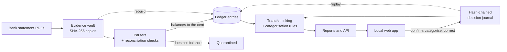

# FinCL

**Your bank statements, turned into a ledger you can check.**

FinCL is a local-first personal finance app for Singapore bank statements. Give
it the PDFs your banks already send you (DBS, DBS PayLah!, MariBank, Mari credit
card, Trust Bank and Revolut) and it builds one exact ledger: every figure
traces back to a line on a statement, every statement must reconcile to its own
printed balances, and nothing leaves your machine.

- **Evidence, not guesses.** A statement that does not balance to the cent is
  quarantined, not imported. An ambiguous transfer is proposed for review,
  never matched silently.
- **Every decision is replayable.** Categories, confirmed transfers and
  corrections go into a hash-chained decision journal, so the whole database
  can be rebuilt from your statements plus that journal.
- **Answers, not just transactions.** Cash position, a six-month forecast,
  "Will I have enough?", debts, cards and instalments, budgets, sinking funds,
  trips and net worth.
- **Exact money.** Integer amounts, never floating point, and FX rates loaded
  explicitly with their provenance.



## Try the demo

The demo is an isolated ledger built from entirely invented statements, so you
can explore and develop the app without any real data. It has the shape of a
lived-in ledger: six accounts on different statement cycles, money moving between
them, a card with installment plans, and to-dos left open on purpose. It needs uv
and Node.js:

```sh
uv sync --locked
npm ci --prefix frontend
npm run build --prefix frontend
uv run python scripts/create_demo.py /tmp/fincl-demo
uv run fincl serve --database /tmp/fincl-demo/demo.sqlite3 --demo --open
```

Edits persist in the demo ledger. Statements end a month or two before the build
date, so delete the directory and build it again to bring it forward. For
hot-reloading development, `uv run python scripts/dev.py` builds the same ledger
in `demo-ledger/` and serves only a ledger built this way. See
[frontend setup and scope](frontend/README.md) for more on the demo and the app's
launch and session behaviour.

## Use it with your own statements

Keep the ledger and evidence outside the folder your statements live in; FinCL
never modifies the source files. The first import creates the ledger, then the
app takes over:

```sh
uv run fincl import-dbs path/to/dbs-statement.pdf \
  --database var/fincl.sqlite3 --evidence-dir var/evidence
uv run fincl serve --database var/fincl.sqlite3 --evidence-dir var/evidence --open
```

From there, the app's Setup page uploads further PDFs (several banks at once,
recognised automatically). The app opens only an existing ledger at the current
schema and never migrates on startup; upgrade with `fincl migrate`.

Everything runs locally: PDF parsing, evidence storage, SQLite, reports and
transfer matching. Encryption at rest is not implemented yet. The evidence
vault and database are plaintext stores protected by owner-only filesystem
permissions, so full-disk encryption is recommended.

## What's in the app

The local web app has 28 destinations in six navigation-rail sections
(`frontend/src/lib/tabs.ts` is the single source for the rail and the command
palette):

- **Overview**
- **Money in & out:** Transactions, Analysis, Income, Categorization,
  Categories, Rules, Review, Reports, Trips
- **Commitments:** Obligations, Debts, Cards, Installments
- **Planning:** Planning, Budgets, Recurring, Annual funds, Controls
- **Position & forecast:** Will I have enough, Baseline, Cash, Forecast, Net
  worth, Variance
- **Setup & data:** Accounts, Setup, Maintenance

`Cash Flow` and `Money Owed` are aliases for Analysis and Obligations, reachable
by URL and the command palette but not rail rows of their own. The transaction
list is paged and filtered by the backend (`GET /api/v1/transactions`, keyset
cursor, generation-pinned). Every write goes through one application writer
(one ledger lock, generation-checked preview, request-id idempotency), and the
CLI sees the same journal decisions.

Serving is key-free by default. Add `--require-access-key` to re-enable the
one-use launch key and session gate.

## How it works

- **Evidence.** Each statement is copied byte for byte into a SHA-256-addressed
  evidence vault and verified before extraction.
- **Exact money.** Amounts are stored as integer coefficients; money never uses
  binary floating point or SQLite `REAL`.
- **One ledger table.** Every processed flow lands in `ledger_entries`
  regardless of source, with a `source_family` discriminator, exactly one raw
  provenance link, a rebuild-stable `natural_anchor`, and typed nullable
  source-specific columns. `transfer_links` carry real foreign keys into it.
- **Statement parsers.**
  - DBS multi-currency PDFs: geometric anchors, rotated-text filtering,
    multiline descriptions and exact balance walks.
  - PayLah: both observed layouts, missing-year inference bounded by the
    statement period, row coverage, references and exact statement balances.
  - MariBank savings: two frozen interest profiles, daily-interest rows kept
    supporting, the credited-interest line at `MONTH` precision, and exact
    ending/summary/interest reconciliation.
  - Mari credit card: posted and transaction dates kept separate, foreign
    amount and currency preserved with a magnitude-derived implied rate,
    instalment occurrences recorded as facts, and two-layer reconciliation
    (section totals → the statement's own printed equation → current
    outstanding → statement due).
  - Trust Bank: the printed statement period, the `Main Account` and `Savings`
    sub-account ledgers, foreign-currency purchases with their applied rate,
    and exact per-sub-account and printed-summary reconciliation.
  - Revolut PDFs: per-currency-pocket running balances and lifecycle
    preservation.
- **Transfer links.** Narrow deterministic DBS-to-PayLah, DBS-to-Revolut,
  DBS-to-MariBank (PayNow reference token + amount) and MariBank-to-Mari-card
  repayment links. DBS debit-card Revolut top-ups match on the card-transaction
  date printed in the merchant line (DBS posts the debit days later), not the
  posting date. Ambiguous matches are `PROPOSED` for review rather than
  guessed, except a balanced same-day group of identical DBS-to-PayLah top-ups
  (no shared reference, both legs owner-owned, every pairing nets alike), which
  is auto-confirmed on one deterministic bijection.
- **Decision journal.** An owner-only, fsync-durable, hash-chained journal
  beside the database, with rebuilt SQLite projections for reviewed links,
  repairs, invariant escapes, inbound classifications, and categorization
  rules, aliases and overrides. The kind vocabulary is closed: replay refuses
  an unrecognized `decision_kind` rather than dropping it. Decisions whose
  anchor no longer resolves are surfaced as `dangling_decisions` in `report` /
  `coverage` and as a non-zero `rebuild` exit code.
- **Extraction runs.** One analytically selected extraction run per evidence
  blob (`extraction_runs.selection_state`, a partial unique index), so a
  parser-version bump cannot double-count the ledger or split an override's
  binding; stale-only evidence is reported as `needs_reextraction`.
- **Categorization.** A frozen `taxonomy-2026-v1` code constant, a versioned
  per-source field projection and merchant normalization, journaled rule
  authoring, and a six-tier precedence engine (override → confirmed link /
  inbound → direct then alias-resolved merchant rule → description / PayNow
  rule → unclassified) with exact currency-qualified amount bands and an
  asymmetric direction check. Each run is recorded in a reproducible
  `categorization_runs` manifest whose id is a hash of every input version.
  Unclassified, ambiguous, direction-conflict, migrated and
  missing-description counts surface as warnings, never hard failures.
- **Economic flow.** Per-currency exact reporting with six inbound buckets
  (income, reimbursements, non-income inflow, other, pending review,
  self-transfer excluded), confirmed internal links excluded, baselines
  filtered to the fully cross-source-covered window, and a consolidated SGD
  total once reference FX rates are loaded (otherwise `null` with a status
  naming why). Receipt-period refunds net positively in a separate bucket.
- **FX rates.** Loaded explicitly (`import-fx-rates`), carried forward verbatim
  by `rebuild`, and applied month by month with a single final rounding to the
  cent. Rate versions are immutable; identical reimports write nothing, and
  changes require a new version. Reports include the exact selected FX inputs
  and their provenance.
- **Planning.** Evidenced liquid balances and manual balance observations
  (`position/`), expense-flexibility tiers (`financial_roles.py`),
  minimum-reserve policy and spending controls (`controls/`), sinking funds
  (`funds/`), a six-month forecast over a dated future-event ledger
  (`forecast/`), and issued snapshots scored against actuals (`variance/`).
  Refund allocation, personal borrowing and lending, credit cards with
  instalment-plan chaining, and trips and country context are also in place.

## Development

The project is managed with uv and pinned to Python 3.13 (`requires-python =
">=3.13"`). The committed `uv.lock` provides reproducible dependency versions;
`.venv/` is generated locally and ignored.

```sh
uv sync --locked
uv run ruff check .
uv run mypy
uv run pytest
```

CI (`.github/workflows/ci.yml`) runs the same three on every push and pull
request. In `frontend/`: `npm run build` (TypeScript), `npm test` (Vitest), and
`npm run test:browser` (Playwright, desktop + 1024px, needs `npm run build` and
`npx playwright install chromium` first). The browser suite serves a synthetic
ledger on port 8799; set `FINCL_E2E_PORT` to run it from several checkouts at
once.

Supported toolchain: Python 3.13, the committed `uv.lock`, and
`frontend/package-lock.json`; other versions are unsupported.

### Database schema

`fincl` refuses to open a database whose recorded `schema_version` differs from
the running build's; normal startup never migrates. The current schema is v23
(9 added `projection_generation` and `command_receipts`; 10–12 the analysis
component, relationship and bulk-action projections; 13 personal debts; 14–17
card statement facts, facilities/limits, installments and manual bill
allocation; 18 the planning tables; 19 `balance_observations`; 20
`component_provenance`; 21 the sinking-fund tables; 22 the forecast-snapshot and
match tables; 23 the `reporting_policy` singleton). Each step from 19 on adds
projection tables only, with no data rewrite: they stay empty until the next
journal replay or refresh populates them. `fincl migrate
--database PATH --evidence-dir PATH --backup-output NEW` captures and verifies a
pre-upgrade backup and then applies each registered, checksummed step in one
transaction. Historical reconstruction supports the current schema only; an
older database needs a tested reader or the migration before recovery. Rebuild
preserves the database inventory and FX inputs, re-imports verified evidence,
and replays the journal.

A backup taken after edits made in the app restores to a separate directory
with its decisions and report values intact; `tests/test_mvp_backup_workflow.py`
covers this.

## CLI

**The CLI is deprecated for new features.** New functionality is built in the
app only, as a FastAPI route plus a feature view. The CLI is feature-frozen, not
removed: every command documented here keeps working and keeps being fixed, but
it will not grow to match new app capabilities.

Seven commands are not deprecated and remain the supported operations and
recovery surface, because the app cannot perform them: `serve` (the only way to
launch the app), `migrate` (the app refuses to open a ledger at a different
schema), `backup`, `restore`, `rebuild`, `adopt-ledger` and `repair`.

Use a database and evidence directory outside the read-only source folder:

```sh
uv run fincl import-revolut-pdf path/to/revolut-statement.pdf \
  --database var/fincl.sqlite3 --evidence-dir var/evidence

uv run fincl import-dbs path/to/dbs-statement.pdf \
  --database var/fincl.sqlite3 --evidence-dir var/evidence

uv run fincl import-paylah path/to/paylah-statement.pdf \
  --database var/fincl.sqlite3 --evidence-dir var/evidence

uv run fincl import-maribank path/to/maribank-savings.pdf \
  --database var/fincl.sqlite3 --evidence-dir var/evidence

uv run fincl import-mari-card path/to/mari-card-statement.pdf \
  --database var/fincl.sqlite3 --evidence-dir var/evidence

uv run fincl import-trust path/to/trust-savings-statement.pdf \
  --database var/fincl.sqlite3 --evidence-dir var/evidence

# Rebuild the read projection and publish a new generation token. Query
# commands below run this first unless given --no-refresh.
uv run fincl refresh --database var/fincl.sqlite3

uv run fincl coverage --database var/fincl.sqlite3
uv run fincl profile --database var/fincl.sqlite3
uv run fincl report --database var/fincl.sqlite3
uv run fincl economic-flow --database var/fincl.sqlite3
# Deliberately report a fully covered analysis period:
uv run fincl economic-flow --database var/fincl.sqlite3 \
  --start 2026-01-01 --end 2026-03-31
uv run fincl link-transfers --database var/fincl.sqlite3

# Load reference FX rates so economic-flow can produce a consolidated SGD total.
# JSON:
uv run fincl import-fx-rates --file path/to/rates.json \
  --database var/fincl.sqlite3
# ...or MAS's own "Exchange Rates (Weekly)" CSV, reduced to each month's last
# end-of-period value:
uv run fincl import-fx-rates --file "path/to/Exchange Rates.csv" \
  --mas-weekly-csv --source-version mas-weekly-2026-09 \
  --database var/fincl.sqlite3

# Inspect and decide proposed links. Anchors are printed by `review list`.
uv run fincl review list --database var/fincl.sqlite3 --json
uv run fincl review confirm-link --database var/fincl.sqlite3 \
  --left '<anchor>' --right '<anchor>' --reason "same transfer"
uv run fincl review reject-link --database var/fincl.sqlite3 \
  --left '<anchor>' --right '<anchor>' --reason "not an internal transfer"
# A manual pair automation never proposed needs an explicit kind:
uv run fincl review confirm-link --database var/fincl.sqlite3 \
  --left '<anchor>' --right '<anchor>' --link-kind CURRENCY_EXCHANGE \
  --reason "matched by hand from the statements"

# Classify an inbound entry, or downgrade a live invariant violation.
uv run fincl review classify-inbound --database var/fincl.sqlite3 \
  --anchor '<anchor>' --as income --reason "monthly salary"
uv run fincl review escape-invariant --database var/fincl.sqlite3 \
  --code EXCHANGE_PAIRING_INCOMPLETE --anchors '<anchor>' \
  --reason "second leg is in the next export"

# Categorize every entry, author rules, and review what stayed uncategorized.
uv run fincl categorize --database var/fincl.sqlite3
uv run fincl rules add --database var/fincl.sqlite3 \
  --merchant "EXAMPLE GROCER" --category "Food & Dining / Groceries" \
  --reason "recurring grocer"
uv run fincl rules add --database var/fincl.sqlite3 \
  --paynow-to "EXAMPLE LANDLORD" --currency SGD --min-amount 500.00 \
  --category "Housing / Rent" --reason "rent, not the utilities"
uv run fincl rules alias "Corner Mart" --database var/fincl.sqlite3 \
  --pattern exact:CORNER-MART --pattern "prefix:CORNER-MART-"
uv run fincl rules list --database var/fincl.sqlite3 --json
uv run fincl review categorize '<anchor>' --database var/fincl.sqlite3 \
  --as "Shopping / Electronics" --reason "one-off, receipt attached"
uv run fincl review list --kind uncategorized --database var/fincl.sqlite3 --json

# Recreate a separate database from preserved inventory, FX, evidence, and journal. The output must
# not already exist; this never overwrites the active ledger.
uv run fincl rebuild --database var/fincl.sqlite3 --evidence-dir var/evidence \
  --output var/fincl-rebuilt.sqlite3

# Only after inspecting a FAILED run, or a crashed RUNNING run:
uv run fincl repair ext_... --database var/fincl.sqlite3 \
  --reason "retry after interrupted local import"

# One-time for a ledger created before the journal association existed:
uv run fincl adopt-ledger --database var/fincl.sqlite3

# Capture a verified backup bundle, then restore it into a new directory:
uv run fincl backup --database var/fincl.sqlite3 --evidence-dir var/evidence \
  --output var/backup-2026-09-06
uv run fincl restore --backup var/backup-2026-09-06 --output var/restored

# Upgrade the ledger schema (captures and verifies a pre-upgrade backup first):
uv run fincl migrate --database var/fincl.sqlite3 --evidence-dir var/evidence \
  --backup-output var/premigration-2026-09-06
```

Append `--plain` for stable text or `--json` for structured output where the
command provides those modes. A quarantined import exits with status 2; a
`rebuild` that leaves journaled decisions unbound exits with status 3; an
operational failure exits with status 1.

### Operations: journal, rebuild, backup and restore

`repair` first records an `EXTRACTION_REPAIR` decision in the durable journal.
`rebuild` replays that journal into its SQLite projection and reports bound and
dangling decisions. The legacy `recover-extraction` command remains available
for existing scripts.

Each ledger database is bound to its decision journal by a `ledger_association`
row and a `decision-journal.identity.json` file, with a sequence/hash checkpoint
that detects removal of a complete journal tail. A new ledger is bound on its
first import; a ledger created before this must be bound once with
`fincl adopt-ledger`. Opening a ledger whose journal is missing, shorter than
its checkpoint, or from a different ledger is refused with a restore
instruction. `rebuild` accepts only a same-directory output: it produces a
replacement candidate that keeps the source identity and shares the one
journal; relocation uses the verified backup/restore bundle.

Reconstruction inventories every stored evidence blob independent of analytical
selection, groups extraction history by blob and source family, and refuses a
blob that dispatches to more than one family or has no supported extraction
history, without deleting the bytes. It verifies every evidence object before
staging, checks the candidate for evidence-set and exact FX-row equality, and
reopens it through the normal read path before a no-clobber publish. A source
database whose schema version this build has no reader for is refused with the
list of versions it does support.

`fincl backup` captures a `backup-v1` bundle (the database via SQLite's backup
API, the journal and identity file at the checkpoint, every inventoried evidence
object, and a manifest of checksums, FX versions and a decision summary) under a
backup writer lock, verified and published with no overwrite. `fincl restore`
rejects symlinks and traversal, verifies every checksum, reopens the candidate
through the normal read path, compares it to the manifest, and publishes a new
ledger directory without switching the active one. Every mutating command (CLI
writes, in-app writes, imports, refresh and migration) takes the same ledger
writer lock, so a backup serializes against concurrent imports and edits rather
than racing them. Schema upgrades are explicit: `apply_pending_migrations`
requires a verified backup, runs each step in one transaction with an integrity
check, and stamps the new version only at commit.

## Current limits

- Encryption at rest is not implemented; use full-disk encryption.
- Transfer matching covers the specific bank pairs listed above; generalized
  transfer matching is not implemented yet.
- The conservative default withholds a consolidated total when entries fall
  outside the global covered intersection; an explicit `economic-flow` window
  wholly inside that intersection produces the total. Per-flow coverage is a
  future refinement.
- Purchase attribution for refunds outside the receipt period is deferred.
